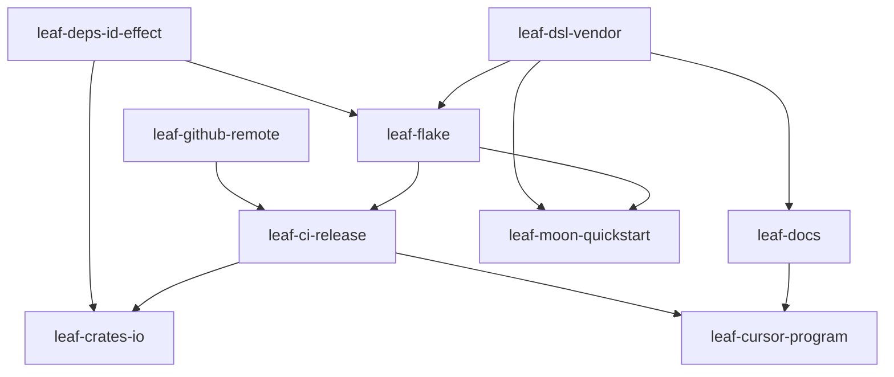

# Execution overlay: assay-public-release

Mission: `pln-mslqjm68-f5rkwl`  
Spec: `.maestro/specs/assay-public-release.md`

## Wave table

| Wave | Tasks (slug) | Parallel? | Blocked by |
|------|--------------|-----------|------------|
| 0 | leaf-deps-id-effect, leaf-dsl-vendor, leaf-github-remote | yes | — |
| 1 | leaf-flake, leaf-docs | yes | wave 0 (deps + DSL for flake/docs accuracy) |
| 2 | leaf-ci-release, leaf-moon-quickstart | yes | wave 1 (flake exists; DSL in tree) |
| 3 | leaf-crates-io | no | wave 2 (CI green; versions stable) |
| 4 | leaf-cursor-program | no | wave 2 (needs GH release artifact or flake pin) |

## Dependency graph

## Definition of done (mission)

Cold machine: follow root README → install → `assay run` documented smoke suite → exit 0.  
Industrial: `cursor.features.program-assay.enable = true` installs pinned binary; dogfood suite runs.
